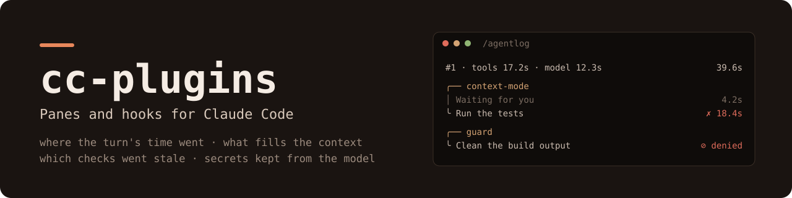

<p align="center">
  
</p>

<p align="center">
  <a href="LICENSE"></a>
  <a href="https://code.claude.com/docs/en/plugins"></a>
  <a href=".claude-plugin/marketplace.json"></a>
  
</p>

<p align="center">
  <code>claude-code</code> · <code>observability</code> · <code>context-window</code> · <code>hooks</code> · <code>secrets</code> · <code>tui</code>
</p>

Claude Code tells you what it did. It is much quieter about why a turn took 40 seconds, which hook let a command through, what is eating your context window, or whether the tests it ran still hold after its last edit. These plugins put that on screen: panes you open when you want them, and a single line above the prompt when something needs you.

One more does the opposite job: [redact](plugins/redact) hides what your rules match, plus the secrets in your `.env` files, from the model, while the tools it calls still get the real values.

## Install

```
/plugin install <plugin> --marketplace dboeter/cc-plugins
```

Answer `y` to add the marketplace, then pick a scope. Each plugin works on its own; install the ones you want.

## The plugins

### Follow a session

**[session-pane](plugins/session-pane)** · `/session-pane`\
Flags checks that no longer hold: a test that failed, one that passed before Claude edited again, or code changed with nothing run. One press reruns the stale ones. The pane adds your goal, the diffs so far and what needs you.

**[context-budget](plugins/context-budget)** · `/contextbudget`\
The context window explained for people new to Claude Code: room left before auto-compact, one stacked bar of what fills it, a plain note per part, and how it grew turn by turn.

**[auto-title](plugins/auto-title)**\
Names the session from your first prompt with Haiku, so the session list says what each one was about. No setup, no note in the conversation.

### Debug a session

**[agent-log](plugins/agent-log)** · `/agentlog`\
Why was that turn slow, and who allowed that call? Splits each turn's time across the model, tools, hooks and waiting on you, and names who decided each call: you, a hook or the classifier. Request prices too, with no telemetry setup.

**[event-log](plugins/event-log)** · `/eventlog`\
The raw record behind agent-log: every event in the session, who raised it, and its full payload on disk. For plugin authors and anyone who wants to see exactly what crossed.

### Keep secrets out of the model

**[redact](plugins/redact)** · `/redact`\
Swaps what your rules match for numbered placeholders before the model sees it, and puts the real value back in tool calls and your terminal. It fails closed. Secret-looking values in the starting folder's env files are masked from the first request; everything else waits until you turn a rule on, because no rule is on by default. It is a pattern list, not a guarantee: read [what it does not protect against](plugins/redact/README.md) and [HARDENING.md](plugins/redact/HARDENING.md) before you rely on it.

## Develop

Adding a plugin: put it in `plugins/<name>/` and add `{ "name": "<name>", "source": "./plugins/<name>" }` to the marketplace's `plugins`, then bump the plugin count badge above.

Every plugin is typed against one copy of Claude Code's plugin API, `plugins/types/claude-code.d.ts` (its first line names the Claude Code version), through `plugins/tsconfig.json`:

```
tsc -p plugins
```

A plugin loads no file outside its own folder, so code two plugins share lives once in `plugins/shared/` and is copied into each by `plugins/shared/sync.sh` (`--check` exits 1 when a copy is stale). Today that is the secret scrub agent-log and event-log use.

After a Claude Code update, replace that file with the new build's: the plugin-authoring skill writes it as `types/claude-code.d.ts` each time the skill loads. A plugin loaded with `--plugin-dir` still gets its own `.claude-plugin/types/` and, without one of its own, a `tsconfig.json`; both are gitignored.

## License

[MIT](LICENSE)
